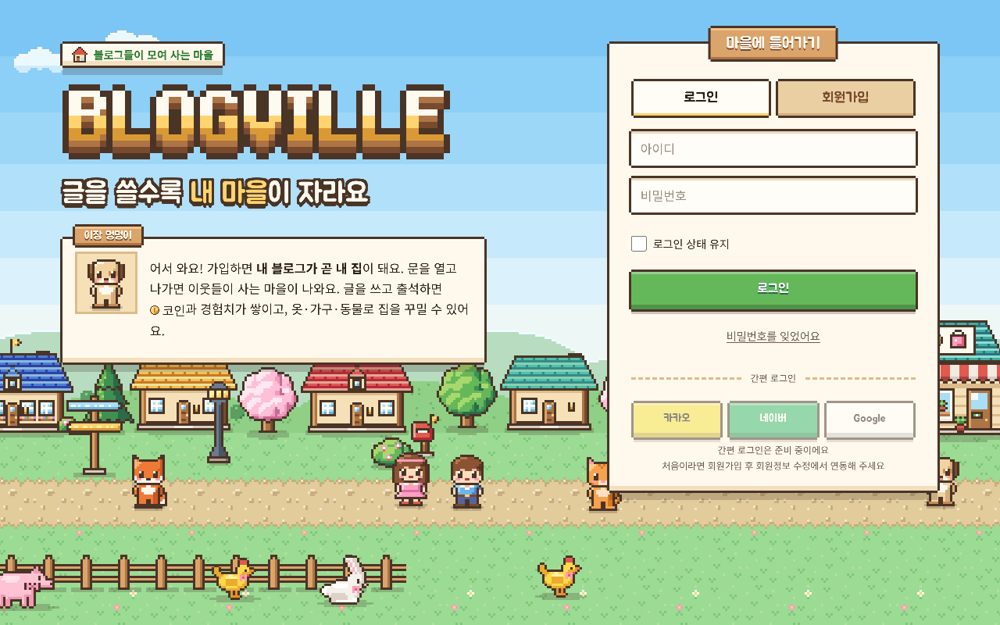
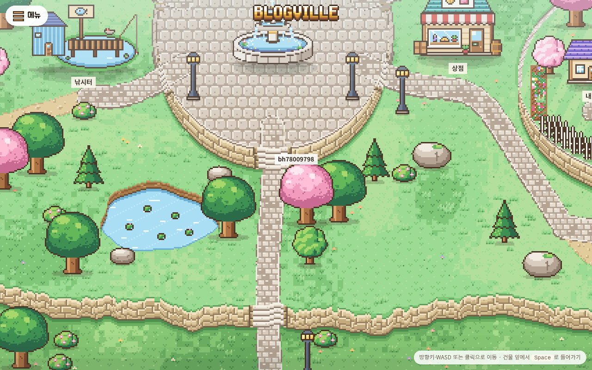
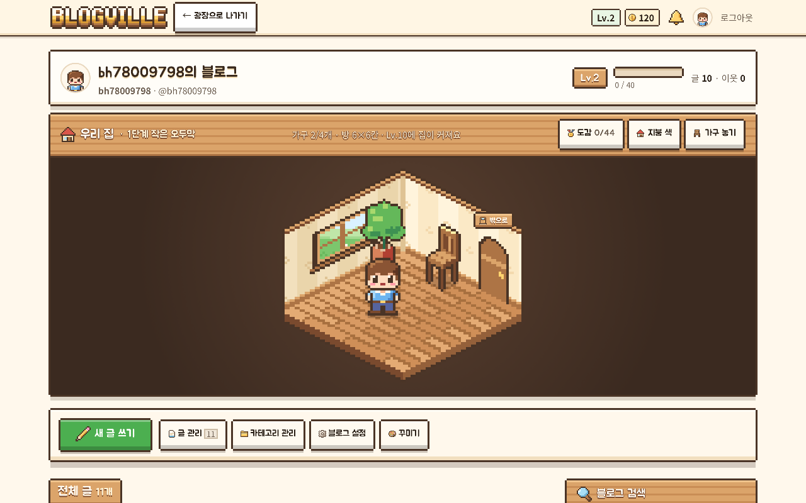
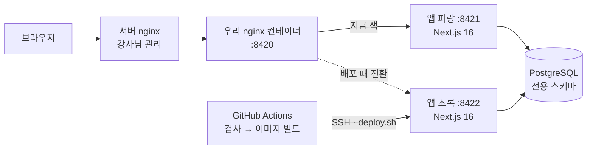
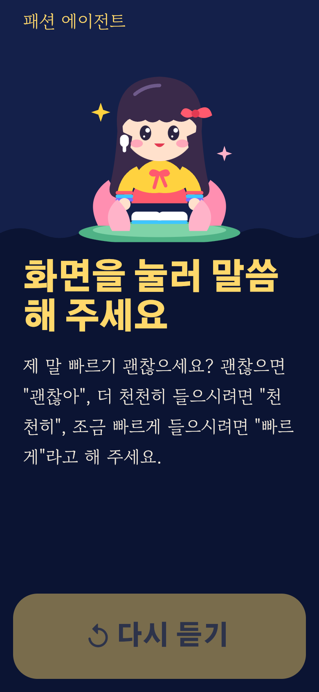
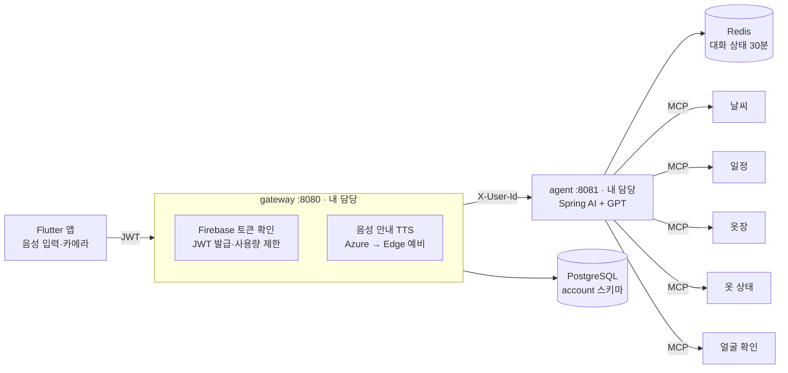

# 이진행 | 풀스택 개발자

> 화면에서 서버, 배포까지 직접 만들고 **숫자로 확인하며 고치는** 개발자입니다.
> 게임형 블로그 Blogville에서 팀 리드로 요구사항·ERD부터 무중단 배포까지 맡았고,
> 음성 AI 코디 도우미 패션 에이전트에서는 팀장으로 Spring Cloud Gateway와 LLM 에이전트 서버를 담당했습니다.

📧 jinhaeng2996@naver.com · 🐙 [github.com/ehgo508](https://github.com/ehgo508)

### 기술 스택

| 분야 | 기술 |
| --- | --- |
| 프론트엔드 | TypeScript, React, Next.js 16(App Router), Tailwind CSS, Flutter |
| 백엔드 | Java·Spring Boot, Spring Cloud Gateway, Spring AI(MCP), Node.js(Server Action), FastAPI |
| 데이터 | PostgreSQL, Drizzle ORM, Flyway, Redis, SQLite |
| 인프라·품질 | Docker, nginx(블루-그린 배포), GitHub Actions, Playwright E2E, Lighthouse |
| AI·엣지 | OpenAI API, PyTorch, ONNX Runtime, TensorRT, Jetson Orin Nano |

### 자격증

| 자격증 | 취득 |
| --- | --- |
| 정보처리기사 | 2026.06 |
| SQLD | 2026.03 |
| 한국사능력검정시험 2급 | |

---

# 🛠 프로젝트 포트폴리오

> 직접 만들고, 측정하고, 고친 기록입니다. **진행한 순서대로** 정리했습니다.
> 프로젝트마다 실제로 부딪힌 문제 2~3개를 **문제 → 원인 → 해결 → 성능 변화** 순서로 적었고, 근거가 되는 커밋·PR·보고서 링크를 달았습니다.

| # | 기간 | 프로젝트 | 성격 | 핵심 기술 |
| --- | --- | --- | --- | --- |
| 1 | 2026.03 ~ 06 | [CourseBox](#1-coursebox--ai-여행-코스-추천) | 산학 팀 프로젝트 (4명) · 팀장 | React, FastAPI, TourAPI, OpenAI API |
| 2 | 2026.10 | [개발 일지 블로그](#2-개발-일지-블로그--정적-사이트--sqlite--github-actions) | 개인 | HTML/JS, SQLite(sql.js), Python, GitHub Actions |
| 3 | 2026.10 | ⭐ [Blogville](#3-blogville--글을-쓸수록-마을이-자라는-게임형-블로그) | 팀 (3명) · 팀 리드 | Next.js 16, TypeScript, PostgreSQL, Drizzle, Phaser, Playwright, Docker |
| 4 | 2026.10 | [실내 환경 시계열 추론](#4-실내-환경-시계열-추론--co₂온도-예측이상-탐지-상시-서비스) | 개인 · 엣지 AI | PyTorch(GRU), Chronos-2, ONNX Runtime, TensorRT, MQTT |
| 5 | 2026.10 | [EmbeddingGemma 2 멀티모달 검색](#5-embeddinggemma-2--엣지에서-멀티모달-검색과-동작-인식) | 개인 · 엣지 AI | sentence-transformers, 미세 조정, YOLO-pose, YOLOE |
| 6 | 2026.10 ~ 11 | [Jetson 카메라 응용](#6-jetson-카메라-응용--재실-인원근접-경고-통합-서비스) | 개인 · 엣지 AI | Jetson Orin Nano, YOLO11 + TensorRT, OpenCV 스테레오, MQTT |
| 7 | 2026.10 ~ 11 | ⭐ [패션 에이전트](#7-패션-에이전트--시각장애인용-음성-ai-코디-도우미) | 팀 (3명) · 팀장 · 게이트웨이·agent 담당 | Java, Spring Boot, Spring Cloud Gateway, Spring AI(MCP), Flutter |

**⭐ 대표 프로젝트** 풀스택 역량을 가장 잘 보여 주는 두 프로젝트입니다.
- **[Blogville](#3-blogville--글을-쓸수록-마을이-자라는-게임형-블로그)**: 팀 리드. Next.js 화면부터 PostgreSQL 설계, E2E 테스트, Docker 블루-그린 무중단 배포까지 한 서비스를 끝까지
- **[패션 에이전트](#7-패션-에이전트--시각장애인용-음성-ai-코디-도우미)**: 팀장. Spring Cloud Gateway(인증·사용량 제한·음성)와 LLM 에이전트 서버를 맡아 MSA 구조로 구현

**엣지 AI** 4~6번은 Jetson Orin Nano 한 대에서 모델을 최적화하고(TensorRT·ONNX) 상시 서비스로 운영한 과제입니다.

### 한눈에 보는 성능 개선

| 프로젝트 | 개선 | 전 → 후 |
| --- | --- | --- |
| 개발 일지 블로그 | 글 배포 | 수동 빌드·DB 커밋 → push만 하면 자동 배포 (빌드 6초 + 배포 12초) |
| Blogville | 상점 페이지 크기 | 0.9MB → 0.4MB |
| Blogville | 블로그 첫 화면 (휴대폰 Lighthouse 성능) | 81점 → 87점 (HTML 77KB → 56KB) |
| 실내 환경 시계열 | 60분 CO₂ 예측 (실습실) | 직전값보다 18% 나쁨 → 22% 좋음 (Chronos-2는 39%) |
| 실내 환경 시계열 | 경보 중복 (3시간) | 38건 → 20건 |
| EmbeddingGemma 2 | 박수 오판정 (가만히 있을 때) | 11~19회 → 0회 |
| Jetson 카메라 | 웹캠 영상 지연 | 742~860ms → 7~36ms |
| Jetson 카메라 | 카메라 끊김 감지 | 30초 → 3초 |
| 패션 에이전트 | GPT 옷 확인 응답 | 25초 초과 → 대부분 1~4초 |
| 패션 에이전트 | 음성 안내(TTS) 문장당 지연 | Edge 0.8~1.8초 → Azure 0.15~0.57초 (실패 시 Edge로 자동 전환) |

---

## 1. CourseBox — AI 여행 코스 추천

**한 줄 소개** 여행 지역·출발/종료 시각·필수 방문지를 입력하면 공공데이터 관광지 정보와 GPT로 시간대별 코스를 짜 주는 웹앱.

- 저장소: [coursebox-app](https://github.com/ehgo508/coursebox-app)
- 기술: React(Vite, Tailwind), FastAPI, SQLite, 한국관광공사 TourAPI, OpenAI API
- 성격: **산학 팀 프로젝트(4명), 팀장·풀스택.** 처음 한 팀 작업이라 Git 협업 방식을 몰라, 팀원들의 작업을 제가 모아 한 저장소에 올렸습니다.

### 🔧 트러블슈팅

#### ① 프론트에서 백엔드 API 호출이 막힘
| | |
| --- | --- |
| **문제** | React 개발 서버에서 FastAPI를 부르면 브라우저가 응답을 막음 |
| **원인** | React 개발 서버와 FastAPI가 서로 다른 포트(출처)에서 돌아, 브라우저의 CORS 정책이 응답을 막음 |
| **해결** | FastAPI에 `CORSMiddleware` 추가, 공공데이터 호출에 상태 코드별 오류 응답 추가 |
| **변화** | 프론트에서 관광지 조회·코스 생성 API 호출 성공 |
| **근거** | [커밋 034d8aa](https://github.com/ehgo508/coursebox-app/commit/034d8aa) |

#### ② API 키가 코드에 그대로 있음
| | |
| --- | --- |
| **문제** | 공공데이터 API 키를 `main.py`에 직접 적어 공개 저장소에 올라감 |
| **해결** | `.env` + `python-dotenv`로 분리하고 `.gitignore` 적용, 키가 없으면 시작할 때 경고 출력 |
| **변화** | 이후 커밋부터 코드에 키가 남지 않음 |
| **근거** | [커밋 034d8aa](https://github.com/ehgo508/coursebox-app/commit/034d8aa) |

### 💡 배운 점
한 사람이 모든 코드를 올리다 보니 누가 무엇을 바꿨는지 기록이 남지 않았습니다. 이 경험 뒤로 브랜치·PR·코드 리뷰를 공부했고, 다음 팀 프로젝트인 Blogville에서는 PR 120여 개를 리뷰·병합하며 협업했습니다.

---

## 2. 개발 일지 블로그 — 정적 사이트 + SQLite + GitHub Actions

**한 줄 소개** 수업 기록을 Markdown으로 쓰면 Python이 SQLite DB로 빌드하고, 브라우저가 sql.js(WebAssembly)로 직접 SQL을 조회하는 블로그. 학습 잔디·달력·태그·질문 노트·SQL 콘솔 제공.

- 저장소: [blog-basic-devlog](https://github.com/AIP-1/blog-basic-AIGJ_01_013-devlog)
- 기술: HTML·CSS·JavaScript, SQLite + sql.js(WebAssembly), Python(Markdown → DB 빌드), GitHub Actions·Pages

### 🔧 트러블슈팅

#### ① 빌드를 깜빡하면 새 글이 안 보임
| | |
| --- | --- |
| **문제** | 글을 쓸 때마다 `build_db.py`를 직접 돌리고 `blog.db`까지 커밋해야 했고, 원본(Markdown)과 결과물(DB)이 어긋날 수 있었음 |
| **해결** | GitHub Actions로 push → DB 빌드 → Pages 배포 자동화. `blog.db`는 빌드 결과물이라 `.gitignore`. PR은 빌드 검사만 하고, 빌드가 실패하면 배포 중단(`needs: build`) |
| **변화** | 수동 빌드 → **Markdown만 push하면 18초 만에 배포**(빌드 6초 + 배포 12초), 잘못된 글이 사이트를 망가뜨리지 않음 |
| **근거** | [커밋 68d859a](https://github.com/AIP-1/blog-basic-AIGJ_01_013-devlog/commit/68d859a) |

#### ② 워크플로 파일 push가 거절됨
| | |
| --- | --- |
| **문제** | `refusing to allow an OAuth App to create or update workflow ... without workflow scope` |
| **원인** | 워크플로 파일은 GitHub 서버에서 명령을 실행시키므로 별도 `workflow` 권한이 필요한데, 처음 받은 토큰에는 `repo`, `gist`, `read:org`만 있었음 |
| **해결** | `gh auth refresh -h github.com -s workflow`로 권한 추가 |
| **변화** | push와 자동 배포 성공 |

---

## 3. Blogville — 글을 쓸수록 마을이 자라는 게임형 블로그

**한 줄 소개** Tistory 같은 블로그 기능에 캐릭터·2D 광장·출석·상점 같은 게임 요소를 더한 웹 서비스. 요구사항 명세 → ERD → 구현 → E2E 테스트 → Docker 배포까지 진행했습니다.

- 저장소: [wcblogville/blogville](https://github.com/wcblogville/blogville) (커밋 400여 개, PR 120여 개) · 설계 문서: [wcblogville/docs](https://github.com/wcblogville/docs)
- 기술: Next.js 16(App Router), TypeScript, PostgreSQL + Drizzle ORM, Better Auth(카카오·네이버·구글), Tiptap, Phaser 4, Playwright, GitHub Actions, Docker, nginx
- **내 역할:** 팀 리드. 저장소 운영과 PR 리뷰·병합, 요구사항·ERD 작성, 회원·블로그·게임 기능 구현, 배포 파이프라인
- **기여:** 병합된 PR 122개 중 **101개(83%)**를 직접 올림 (2026-11-22, GitHub PR 작성자 기준)

| 첫 화면 (로그인·가입) | 광장 (Phaser 2D 마을) | 블로그 홈 (우리 집) |
| --- | --- | --- |
|  |  |  |

> 화면은 직접 띄운 개발 서버에서 시험 계정으로 찍었습니다. 수업 서버의 배포는 과정이 끝나면 내려갑니다.

**구조와 무중단 배포**

**테스트·자동화 (2026-11-22 기준)**

| 항목 | 수치 |
| --- | --- |
| 단위 테스트 | 13개 파일, 확인 812개 (DB 없이 실행) |
| E2E (Playwright) | 52개 파일, 코드에 적힌 확인 약 1,600개. PR마다 14개 묶음, 매일 밤 51개 전체 |
| 요구사항 ↔ 테스트 연결 | 구현된 요구사항 95개 중 78개(82%)에 테스트, 49개(52%)는 PR마다 자동 확인. 연결표는 스크립트가 만들고 어긋나면 CI 실패 |
| CI 소요 시간 | PR 검사(타입·린트·단위·빌드·E2E) 7~10분, 매일 밤 전체 E2E + Lighthouse 27~33분, 배포(검사 포함) 12~14분 |

### 🔧 트러블슈팅

#### ① 상점 페이지가 무거움
| | |
| --- | --- |
| **문제** | 아이템 그림이 많은 상점 페이지의 HTML이 0.9MB |
| **원인** | 도트 아이콘·아이템 그림을 data URI로 HTML 안에 직접 넣어, 같은 그림도 매번 다시 내려받고 브라우저 캐시를 쓰지 못함 |
| **해결** | 그림을 `/px/<아이콘>` 주소로 분리하고 그림 해시를 버전으로 붙여 **1년 캐시**, 상점 카드 그림은 `loading=lazy` |
| **변화** | 상점 HTML **0.9MB → 0.4MB (약 56% 감소)**, 두 번째 방문부터 그림은 캐시에서 읽음 |
| **근거** | [커밋 b0237fd](https://github.com/wcblogville/blogville/commit/b0237fd) |

#### ② 배포할 때마다 서비스가 끊김
| | |
| --- | --- |
| **문제** | 새 버전을 배포하면 새 앱이 뜰 때까지 사이트가 열리지 않음 |
| **원인** | 배포 스크립트가 옛 컨테이너를 먼저 지우고(`docker rm -f`) 새 컨테이너를 띄우는 방식이라, 그 사이에 응답할 앱이 없음 |
| **해결** | **블루-그린 무중단 배포**: 앱을 8421·8422에 번갈아 띄우고, 새 앱 응답 확인 → `nginx -t`·reload로 전환 → 옛 앱 종료. 새 앱이 응답하지 않으면 새 앱만 지우고 옛 앱 유지. 바로 전 버전으로 되돌리는 rollback 추가 |
| **변화** | 배포 중에도 기존 앱이 계속 응답, 실패한 배포가 서비스를 멈추지 않음. 전환 중 0.2초마다 요청을 보내 실패 수를 배포 로그에 기록 |
| **근거** | [커밋 e12ee10](https://github.com/wcblogville/blogville/commit/e12ee10) |

#### ③ 카테고리별 글 수가 0~1로 나옴
| | |
| --- | --- |
| **문제** | 블로그 홈의 카테고리 글 수가 실제와 다르게 0 또는 1 |
| **원인** | `categories` 표 하나만 읽는 쿼리라 Drizzle이 칸 이름을 **표 이름 없이** 생성해, 서브쿼리의 `"category_id" = "id"`가 카테고리 id가 아닌 `posts.id`와 비교됨 |
| **해결** | 서브쿼리 칸에 표 이름을 명시 |
| **변화** | 글 수 정상 표시. E2E 시나리오(US2-3)로 회귀 확인 |
| **근거** | [커밋 0a01a9d](https://github.com/wcblogville/blogville/commit/0a01a9d) |

#### ④ 공감을 눌렀다 취소하면 코인이 계속 쌓일 수 있는 구조
| | |
| --- | --- |
| **문제** | 공감을 받으면 글 주인에게 코인·경험치를 줌. 공감 → 취소 → 다시 공감을 반복하거나 두 탭에서 동시에 누르면 보상이 여러 번 나갈 수 있음 |
| **원인** | "이미 공감했나?"를 읽고 나서 쓰는 방식은 동시 요청 두 개가 둘 다 "아직 안 함"을 읽을 수 있음. 취소하면 공감 행이 사라져 재공감을 새 공감으로 봄 |
| **해결** | ① 공감 표에 (글, 사람) 유일 제약 + `INSERT … ON CONFLICT DO NOTHING RETURNING`으로 실제로 넣은 요청만 다음 단계로 ② 코인은 **잔액 칸 없이 원장(`point_ledger`)에만 기록**하고, 받는 회원 행을 잠근 트랜잭션(`lockUser`) 안에서 같은 근거(`글id:사람id`)의 보상이 있는지 확인한 뒤 지급 |
| **변화** | E2E로 **동시 공감 10회 → 공감 중복 0행, 보상 1번, 오류 0건** 확인. 취소 후 재공감해도 보상은 다시 나가지 않음 |
| **근거** | [커밋 f9e3330](https://github.com/wcblogville/blogville/commit/f9e3330) · [e2e/social.mjs](https://github.com/wcblogville/blogville/blob/develop/e2e/social.mjs) (US3-6) |

> 그 밖에: 매일 밤 성능 검사에서 블로그 첫 화면 점수가 기준 아래로 떨어진 원인을 찾아, 닫혀 있는 동물 도감 창(44칸 그림)을 **처음 열 때 그리도록** 바꿈. 휴대폰 Lighthouse **81 → 87점**, HTML 77KB → 56KB, FCP 2.6 → 1.8초, LCP 3.9 → 3.3초([PR #134](https://github.com/wcblogville/blogville/pull/134))
>
> 달이 바뀌면 연속 출석이 0일이 되던 버그를 "가장 최근 출석 1건" 기준으로 고치고 달·해 바뀜 경계를 테스트로 고정([c2c3980](https://github.com/wcblogville/blogville/commit/c2c3980))

---

## 4. 실내 환경 시계열 추론 — CO₂·온도 예측·이상 탐지 상시 서비스

**한 줄 소개** 실습실·사무실·회의실 3곳의 12주 실측 CO₂·온도로 예측·이상 탐지·사용 여부 모델을 만들고, Jetson Orin Nano에서 **매분 도는 상시 추론 서비스로 17.8시간(1,068주기) 실패 0회** 가동했습니다.

- 저장소: [timeseries-inference](https://github.com/AIP-1/timeseries-inference-AIGJ_01_013) · [최종 보고서](https://github.com/AIP-1/timeseries-inference-AIGJ_01_013/tree/main/report)
- 기술: PyTorch GRU, 오토인코더, MLP, Chronos-2, ONNX Runtime, TensorRT, MQTT, InfluxDB, systemd

### 🔧 트러블슈팅

#### ① 학습 직후부터 과적합, 예측이 "직전값 유지"보다 나쁨
| | |
| --- | --- |
| **문제** | GRU가 1~3 epoch 만에 과적합. 실습실 60분 예측이 단순 "직전값 유지"보다 18% 나빴음 |
| **원인** | 데이터를 들여다보니 **9/21부터 세 공간 CO₂ 수준이 한꺼번에 낮아짐**(평일 낮 1,200~2,000 → 600~900ppm). 학습 기간이 그 직전에 끝나 모델이 옛 절대 수준을 외움 |
| **해결** | 입력을 절대값에서 **"지금 값 대비 차이"**로, 출력을 변화량으로 변경. 7일치를 매번 다시 읽는 사전학습 모델 Chronos-2와 비교 |
| **변화** | 실습실 검증 **−18% → 0%** 회복, 시험 60분 오차 직전값 대비 **10~22% 개선**(실습실 32.2 → 25.2ppm). Chronos-2는 학습 없이 **16~39% 개선**(실습실 19.5ppm)해 채택 |

#### ② 작은 모델인데 TensorRT가 오히려 느림
| | |
| --- | --- |
| **문제** | 엣지 최적화를 위해 TensorRT로 변환했는데 GRU가 PyTorch GPU보다도 느림 |
| **원인** | 계산 자체는 수 µs인데, GPU에 일을 넘기는 고정 비용(약 0.2~0.5ms)이 지연을 결정. GRU는 TensorRT가 24칸 반복으로 나눠 실행(추정) |
| **해결** | 변환 정확도(CO₂ 차이 최대 0.21ppm, 판정 변화 0건)를 확인한 뒤, 작은 모델 3개는 **ONNX Runtime CPU**로 서비스하고 GPU는 큰 모델용으로 비워 둠 |
| **변화** | 모델당 추론 **0.03~0.19ms**로 가장 빠름. 1분 주기 처리 평균 985ms(주기의 약 2%) |

#### ③ 경보가 켜졌다 꺼졌다 반복
| | |
| --- | --- |
| **문제** | 연속 시험에서 같은 경보가 짧은 간격으로 발생·해제를 반복 |
| **원인** | 기준값 근처에서 값이 오르내리면 매번 새 경보로 판정 |
| **해결** | 발생 1번 → 계속되면 60분마다 1번 → **15분 동안 다시 안 걸려야 해제** |
| **변화** | 3시간 경보 이벤트 **38건 → 20건 (47% 감소)** |

> 그 밖에: 센서 게이트웨이 1대의 시계가 약 5분 빨라 값이 다른 5분 칸에 들어가던 문제를 네트워크 서버 수신 시각(`nsTime`) 기준으로 바꿔 해결

---

## 5. EmbeddingGemma 2 — 엣지에서 멀티모달 검색과 동작 인식

**한 줄 소개** 8GB Jetson에 EmbeddingGemma 2를 올려 텍스트·이미지·음성을 한 벡터 공간에서 검색하고, 물체 검색·동작 인식·카메라 2대 접근 감지로 확장했습니다.

- 저장소: [embedding_gemma2](https://github.com/AIP-1/embedding_gemma2-AIGJ_01_013) · [최종 보고서](https://github.com/AIP-1/embedding_gemma2-AIGJ_01_013/tree/main/report)
- 기술: Jetson Orin Nano, PyTorch(CUDA), sentence-transformers(EmbeddingGemma 2, 미세 조정), Ultralytics YOLO-pose·YOLOE, OpenCV 스테레오, FastAPI

### 🔧 트러블슈팅

#### ① 미세 조정 후 도메인 점수는 올랐는데 일반 질의가 틀림
| | |
| --- | --- |
| **문제** | 강의실 환경 도메인으로 미세 조정한 v1이 점수는 올랐지만, "졸리고 머리가 맑지 않아요"를 CO₂가 아닌 조명 문장으로 답함 |
| **원인** | 학습 데이터 198쌍 중 "두통 = 조명" 쌍에 과적합 |
| **해결** | 에폭 3 → 1, 학습률 2e-5 → 1e-5로 낮춘 v2. 도메인 점수와 일반 질의를 **함께** 평가 |
| **변화** | accuracy@1 **0.783 → 0.800**, ndcg@10 0.910 → 0.916, 일반 질의 정답 유지 → v2 채택 |

#### ② 박수 인식: 가만히 있어도 오판정
| | |
| --- | --- |
| **문제** | "손목이 가까우면 박수" 규칙이 가만히 있어도 오판정, 기준을 조이면 진짜 박수를 놓침 |
| **원인** | 15fps에서는 손이 맞닿는 순간이 거의 찍히지 않음 |
| **해결** | 거리 대신 **1.5초 안에 벌렸다 모으기 3회 왕복**을 세는 규칙으로 변경 |
| **변화** | 가만히 있을 때 오판정 **11~19회 → 0회**, 박수 3세트 → 정확히 3회, 만세 중 오판정 0회 |

#### ③ 동영상 임베딩에서 메모리 부족
| | |
| --- | --- |
| **문제** | 동영상 21프레임을 한 번에 넣으면 메모리 부족 |
| **원인** | 보드 한 대를 여러 프로그램이 같이 써서 모델 로드 전부터 5~7GB 사용 중 |
| **해결** | 구성별 RAM·지연을 따로 측정하고, 프레임을 `batch_size=4`로 나눠 입력 |
| **변화** | 8GB 보드에서 텍스트·이미지·음성·동영상 검색 모두 동작(텍스트 146ms, 전체 구성 RAM 6.1GB) |

---

## 6. Jetson 카메라 응용 — 재실 인원·근접 경고 통합 서비스

**한 줄 소개** Jetson Orin Nano 한 대에서 IP 카메라 재실 인원 계수와 웹캠 2대 스테레오 근접 경고를 한 서비스로 묶어 **12시간 재시작 0회, 상태 점검 4,320/4,320 정상**으로 운영했습니다.

- 저장소: [practice_task_for_jetson_camera_applications](https://github.com/AIP-1/practice_task_for_jetson_camera_applications-AIGJ_01_013) · [최종 보고서](https://github.com/AIP-1/practice_task_for_jetson_camera_applications-AIGJ_01_013/tree/main/report)
- 기술: YOLO11 + TensorRT FP16(PyTorch 25.2ms → 4.0ms), YOLO-pose, YOLOE, OpenCV SGBM 스테레오, NVDEC, MQTT, systemd

### 🔧 트러블슈팅

#### ① 처리가 느리면 영상 지연이 끝없이 쌓임
| | |
| --- | --- |
| **문제** | 웹캠은 0.8초 뒤처진 채 고정, IP 카메라는 105초 동안 지연이 계속 늘어남 |
| **원인** | 웹캠 드라이버 버퍼가 약 4장이고, RTSP는 FFmpeg가 프레임을 버리지 않고 쌓음. 처리(약 3fps)가 카메라(25fps)보다 느리면 밀림 |
| **해결** | 별도 스레드가 계속 읽고 **가장 최신 1장만** 넘기는 리더(`camlib.py`) 구현 |
| **변화** | 웹캠 지연 **742~860ms → 7~36ms**, IP 카메라 1~2초 안 유지 |

#### ② 랜선이 빠지면 30초 동안 멈춤
| | |
| --- | --- |
| **문제** | IP 카메라 연결이 끊겨도 프로그램이 30초 동안 응답 없음 |
| **원인** | FFmpeg 기본 타임아웃이 30초 |
| **해결** | 열기 5초·읽기 3초 타임아웃, 2번 실패하면 다시 열기. 카메라마다 읽기 스레드 분리 |
| **변화** | 끊김 감지 **30초 → 3초**, 복구까지 **58초 → 32초**. 운영 중 웹캠을 뽑아도 9초 뒤 자동 복귀, 다른 카메라는 5fps 그대로 유지 |

#### ③ 스테레오 거리가 "틀린 값을 확신"
| | |
| --- | --- |
| **문제** | 무늬 없는 흰 벽에서 실제 1.35m를 1.43m로, 흔들림(sd 0.6cm) 없이 잘못 측정 |
| **원인** | 무늬가 없으면 좌우 영상 매칭 근거가 없는데도 SGBM이 그럴듯한 시차를 냄. "측정 불가"보다 더 위험한 실패 |
| **해결** | 7×7 밝기 표준편차가 낮은 픽셀 제외(무늬 게이트) + 유효 픽셀 비율 하한 + 1초 중앙값 |
| **변화** | 흰 면에서 틀린 값 대신 "측정 불가" 반환. 사람별 거리 오차 2.7m 이상에서 **±1.3%** 이내 |

---

## 7. 패션 에이전트 — 시각장애인용 음성 AI 코디 도우미

**한 줄 소개** 화면을 보지 않고 말로만 쓰는 옷 추천 에이전트. 날씨·일정을 보고 옷을 추천하고, 폰 카메라로 찍은 옷의 얼룩·찢어짐과 날씨·일정 적합성을 음성으로 알려 줍니다.

- 저장소: [fashion-agent](https://github.com/fashion-agent-team/fashion-agent)(앱) · [gateway](https://github.com/fashion-agent-team/fashion-agent-gateway) · [agent](https://github.com/fashion-agent-team/fashion-agent-agent) · MCP 서버 6개(weather, schedule, closet, clothes-state, face-check, helper)
- 구성: Flutter 앱 → **Spring Cloud Gateway(인증·사용량 제한·TTS/STT)** → **agent(Spring AI + MCP 클라이언트, GPT 판단)** → 기능별 MCP 서버
- **내 역할:** 팀장. `fashion-agent-gateway`, `fashion-agent-agent` (두 레포 README에 담당자로 명시), iOS 빌드 문제 해결, 발표용 음성(TTS) 방식 결정
- **기여:** 팀 3명이 앱·게이트웨이·agent·MCP 서버 8개 저장소에 병합한 PR 278개 중 **102개(37%)**를 올림, 팀원 중 가장 많음. 담당한 gateway는 23개 중 15개, agent는 56개 중 26개 (2026-11-22, GitHub PR 작성자 기준)

> 앱의 첫 화면입니다(웹 빌드로 직접 띄워 캡처). 화면을 보지 않는 사용자를 위해 큰 글씨·높은 대비로 만들고, 모든 안내를 음성으로 읽어 줍니다.

### 🔧 트러블슈팅

#### ① GPT 옷 확인이 25초를 넘겨 규칙 판단으로 떨어짐
| | |
| --- | --- |
| **문제** | 실제 OpenAI 키로 전체 서비스를 돌려 보니 옷 확인 응답이 25초를 넘어, 매번 시간 초과로 GPT 대신 단순 규칙 판단이 나감. 429·장애 때도 25초를 다 기다림 |
| **원인** | 기본 모델(gpt-5-mini)의 추론 시간, Spring AI 기본 재시도 10번 |
| **해결** | `gpt-5.4-mini` + `reasoning none`으로 변경(설정값으로 분리), 재시도 10번 → 2번(1초). 하루 일정 조회처럼 판단이 필요 없는 질문은 GPT 없이 도구를 바로 부르고, 날씨·일정 결과는 2~30분 캐시 |
| **변화** | 옷 확인 응답 **25초 초과 → 대부분 1~4초**, 하루 일정 질문 **2~4.6초 → 도구 한 번**, 장애 시 25초 대기 없이 LLM 없이 되는 기능을 안내 |
| **근거** | agent 커밋 [865caff](https://github.com/fashion-agent-team/fashion-agent-agent/commit/865caff) · [b485374](https://github.com/fashion-agent-team/fashion-agent-agent/commit/b485374) · [5f29ebb](https://github.com/fashion-agent-team/fashion-agent-agent/commit/5f29ebb) |

#### ② 음성 안내: 빠른 Azure, 하지만 무료 한도와 끊김
| | |
| --- | --- |
| **문제** | 음성이 유일한 화면인 앱이라 TTS 지연과 끊김이 곧 사용성. Azure 신경망 음성은 무료 등급 **1분 20회 한도**가 있고 실패하면 아무 소리도 안 남. 문장 조각을 이어 틀면 말 사이 텀이 길게 들림 |
| **원인** | ① 한 서비스에만 의존 ② Azure가 조각마다 앞뒤 무음을 붙여 이어 틀 때 무음이 두 번 들어감 |
| **해결** | 젯슨 로그로 문장당 지연을 비교해 **Azure를 기본, Edge TTS 사이드카를 예비**로 결정. Azure가 실패하거나 **한도에 닿기 전에** Edge로 자동 전환, SSML `mstts:silence 0ms`로 조각 앞뒤 무음 제거, 앱이 보낸 말 빠르기를 서버 음성에도 적용 |
| **변화** | 문장당 지연 **Edge 0.8~1.8초 → Azure 0.15~0.57초**, 한도 초과·장애 때도 음성이 끊기지 않음 |
| **근거** | gateway PR [#11](https://github.com/fashion-agent-team/fashion-agent-gateway/commit/80efa36) · [#12](https://github.com/fashion-agent-team/fashion-agent-gateway/commit/5716ab8) · [#13](https://github.com/fashion-agent-team/fashion-agent-gateway/commit/8045c90) · [#14](https://github.com/fashion-agent-team/fashion-agent-gateway/commit/871a321) |

#### ③ MCP 서버를 다시 켜면 첫 요청만 실패
| | |
| --- | --- |
| **문제** | MCP 서버(예: 날씨)를 재배포한 직후 agent의 첫 도구 호출이 `upstream_failed`로 실패하고, 두 번째부터는 정상 |
| **원인** | agent가 MCP 클라이언트를 서버별로 캐시하는데, 서버가 재시작되면 캐시된 세션은 이미 죽은 세션 |
| **해결** | 실패한 호출이 **캐시된 연결**이었다면 그 연결을 버리고 새로 붙어 **한 번만** 다시 호출. 새 연결도 실패하면 오류 반환(무한 재시도 방지) |
| **변화** | 서버 재배포 직후 첫 요청 실패 → 실패 없이 응답 |
| **근거** | [agent PR #16](https://github.com/fashion-agent-team/fashion-agent-agent/commit/4e83924) |

#### ④ 다른 사람의 옷장을 볼 수 있는 구조와 오래 사는 토큰
| | |
| --- | --- |
| **문제** | 뒤쪽 agent·MCP 서버는 `X-User-Id` 헤더로 사용자를 구분함. 앱이 이 헤더를 조작하면 남의 옷장·일정을 읽을 수 있고, 30일짜리 리프레시 토큰이 새면 오래 악용됨 |
| **해결** | ① JWT는 **게이트웨이에서만** 확인하고, 앱이 보낸 `X-User-Id`는 지운 뒤 확인한 사용자 id로 다시 붙임. 뒤쪽 서비스 포트는 밖에 열지 않음 ② 리프레시 토큰은 **한 번 쓰면 새로 발급**(DB에는 SHA-256 해시만). 이미 쓴 토큰이 다시 오면 도난으로 보고 그 사용자의 리프레시 토큰을 **모두 끊음** ③ 사용자당 분당 30회, 사진 요청 10회 사용량 제한(429) |
| **변화** | 실제 PostgreSQL에 붙인 통합 테스트로 "앱이 넣은 X-User-Id는 JWT의 사용자로 바뀜", "리프레시 토큰 재사용 시 모두 끊김", "토큰 없으면 401"을 확인. 게이트웨이 테스트 38개가 PR마다 CI에서 실행 |
| **근거** | [커밋 ede6ac6](https://github.com/fashion-agent-team/fashion-agent-gateway/commit/ede6ac6) · [GatewayFlowTest](https://github.com/fashion-agent-team/fashion-agent-gateway/blob/main/src/test/java/com/fashionagent/gateway/GatewayFlowTest.java) |

> 그 밖에 해결한 iOS 문제: 카메라 화면에서 앱이 꺼지던 문제를 ML Kit 모델 묶음을 앱에 넣어 해결([7dd5018](https://github.com/fashion-agent-team/fashion-agent/commit/7dd5018)), Firebase SDK 13과 GoogleSignIn 9의 의존성 충돌을 SDK 12.x로 맞춰 해결([191c373](https://github.com/fashion-agent-team/fashion-agent/commit/191c373)), 신호음 뒤 오디오 세션이 꺼져 음성 인식이 아무것도 못 듣던 문제 해결([72a1021](https://github.com/fashion-agent-team/fashion-agent/commit/72a1021))

---

## 공통으로 일하는 방식

- **측정해서 고른다:** 지연·정확도·메모리를 표로 비교한 뒤 방식을 정했습니다 (Azure vs Edge TTS, TensorRT vs ONNX CPU, GRU vs Chronos-2 vs 규칙).
- **실패를 안전하게:** 틀린 값 대신 "측정 불가"를, 서버가 죽으면 예비 경로를, 배포가 실패하면 기존 앱 유지를 택했습니다.
- **테스트로 고정한다:** 찾은 버그는 경계 조건 단위 테스트나 E2E 시나리오로 남겼습니다.
- **기록한다:** 요구사항 명세·ERD·결과 보고서·개발 일지로 결정 이유를 남겼습니다.
